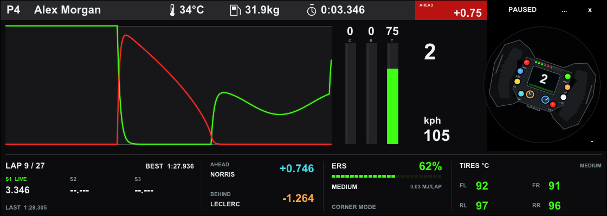

# f126telemetry · F1 25 / 2026 telemetry overlay

A native **C++20 / Dear ImGui / GLFW / OpenGL 3.3** overlay styled after the supplied iRacing telemetry reference: a flat, translucent black horizontal strip with a compact white header, green throttle/red brake traces, three narrow pedal bars, gear/speed, and a rotating steering wheel. It starts in a smoothly animated demo. Click the source badge at the top right and choose **Live F1 UDP** to receive EA SPORTS F1 25 or the **F1 25: 2026 Season Pack**.

A **slim information strip**, visible by default beneath the graph and wheel, uses the same flat black background and compact type: lap count, sectors, best/last laps, ahead/behind gaps, ERS charge and deployment, aero status and four tire temperatures. Driver name, position and the current lap clock remain in the existing header. Press **F2** or click **−** to hide the lower strip; press again to restore it. The wheel is drawn with native vector geometry and turns with the steering input; no external images, bundled fonts, game injection or paid libraries are needed.



## Windows download

[Download the Windows executable and full source](https://github.com/xtpm/f126telemetry/releases/latest/download/APEX-Telemetry-Windows.zip). Extract the ZIP and run **apex_hud.exe**. It starts in demo mode; press **F1** to configure live F1 telemetry. The package includes build instructions, preview images and dependency license notices.

## Build and run

You need a C++20 compiler, **CMake 3.24+**, Git, an OpenGL 3.3 capable graphics driver, and internet access for the first configure. CMake fetches **GLFW 3.4** and **Dear ImGui 1.92.5**, pinned to release commits. No package manager or separate OpenGL loader is needed. System fonts are used, with ImGui's embedded font as fallback; no font downloads are required.

### Windows — Visual Studio 2022 or 2026

Install the **Desktop development with C++** workload, including CMake tools and a Windows SDK. Open a Developer PowerShell / Developer Command Prompt in this folder:

```powershell
cmake -S . -B build -A x64
cmake --build build --config Release --parallel
ctest --test-dir build -C Release --output-on-failure
.\build\Release\apex_hud.exe
```

You can also open this folder in Visual Studio and choose the `apex_hud` target. If `cmake` is not on PATH, use the Developer shell or Visual Studio's bundled CMake. The Windows release uses the static MSVC runtime.

### Linux — X11

```sh
sudo apt install build-essential cmake git libgl1-mesa-dev xorg-dev
cmake -S . -B build -DCMAKE_BUILD_TYPE=Release
cmake --build build --parallel
ctest --test-dir build --output-on-failure
./build/apex_hud
```

This configuration builds GLFW's X11 backend. On Wayland, use XWayland; compositor policy can limit window positioning, transparency, and always-on-top behavior.

### macOS

```sh
xcode-select --install
brew install cmake git
cmake -S . -B build -DCMAKE_BUILD_TYPE=Release
cmake --build build --parallel
ctest --test-dir build --output-on-failure
./build/apex_hud
```

The code requests a forward-compatible core context on macOS. Windows is the locally verified platform; Linux and macOS build paths are supplied but have not been run here.

## Connect F1 25 / the 2026 Season Pack

In the game's **Settings → Telemetry Settings**, set:

| Setting | Value |
|---|---|
| UDP Telemetry | On |
| UDP Broadcast Mode | Off |
| UDP IP Address | `127.0.0.1` when the HUD and game run on the same PC |
| UDP Port | `20777` |
| UDP Send Rate | `60 Hz` recommended; lower rates also work |
| UDP Format | `2025` or the `2026 Season Pack` format |
| Your Telemetry | Public, if needed for the fields you want to share |

Click the source badge (**DEMO 26** initially), select **Live F1 UDP**, or launch with:

```powershell
.\build\Release\apex_hud.exe --live --port 20777 --topmost
```

For a console or another PC, enter the **HUD PC's LAN IPv4 address** in the game. The receiver listens on all IPv4 interfaces. Allow the executable's inbound UDP traffic on your private network if Windows Firewall prompts. Do not forward the port on your router.

If SimHub or another application already occupies `20777`, use a different port in both the game and **Overlay setup** (`...` or F1), or forward telemetry from that application to APEX's port. Click **Connect / restart UDP** after changing the port. Only one game's stream should target the receiver at a time.

Use **windowed or borderless mode in the game**, then enable APEX's **Always on top** option. Exclusive fullscreen can prevent ordinary desktop overlays from appearing. This is a separate native window, with interactive controls; it is not a click-through or injected overlay.

### 2025 versus 2026

Both formats are decoded separately, including the different car counts, telemetry strides, participant identifiers, temperatures, and ERS layout. The 2026 format can carry older cars: the regulations flag determines which aero display to use.

- **2025 cars:** DRS **Closed / Available / Open**. `DRS OPEN` means the DRS flap is reported open; it does not claim the car has 2026 active aero.
- **2026 cars:** active aero **Corner mode / Available / Straight mode**, plus overtake availability and activation. These come directly from packet 16, not from a speed or steering guess.
- For the full 2026 aero display, select the **2026** UDP format in the game. A 2025 stream cannot supply the new active-aero fields.

Protocol reference: [EA's official F1 25 and 2026 Season Pack telemetry specifications](https://forums.ea.com/blog/f1-games-game-info-hub-en/ea-sports%E2%84%A2-f1%C2%AE25-2026-season-pack-udp-specification/12187347), specifically the attached 2025 and 2026 structure definitions. The implementation consumes packet version 1 of IDs **0, 1, 2, 4, 6, 7, 10, 11**, plus **16** for 2026. Unknown formats and versions are rejected with a status message; unused packet types are ignored. Newer game updates that change these layouts may require a decoder update.

## Display and controls

| Control | Action |
|---|---|
| Source badge at top right | Choose Demo 2025 / Demo 2026 / Live F1 UDP, or restart UDP |
| Right-click anywhere | Open the overlay controls menu |
| Space | Freeze/resume the demo, including its graph and wheel |
| + / −, F2 | Show/hide the slim F1 info strip (shown by default) |
| ..., F1 | Connection, demo name, opacity, history length, window size |
| F8 | Toggle always on top |
| F9 | Toggle OS window frame; framed windows can be resized normally |
| Drag the header | Move the window |
| Escape | Close setup, or quit the dashboard |

Keyboard shortcuts require the HUD to have focus. Settings are per run. Command-line options can make a launch shortcut repeatable:

```sh
apex_hud --demo --season 2025 --width 840 --topmost
apex_hud --live --port 20778 --decorated
apex_hud --live --compact --topmost
apex_hud --setup
apex_hud --help
```

The default layout is **1120 × 400**: the **1120 × 280** (4:1) reference strip plus **120 pixels** of matching readouts underneath. `--compact` starts with only the reference strip; `--expanded` explicitly includes the lower readouts. `--width` automatically chooses a matching height unless `--height` is also provided; for example, `--width 840` opens at **840 × 300**. The minimum window is **560 × 140**. Setup offers 560, 840 and 1120 pixel width presets, applied when it closes. The settings dialog temporarily enlarges the same window and restores the overlay's dimensions afterward. Arbitrary aspect ratios are letterboxed; native framebuffer scaling preserves sharp text on high-DPI displays. Transparency requires OS compositor support.

## Reading the dashboard

- **Header:** race position, driver name, track temperature, fuel mass in kg, current lap time, and a red **AHEAD** gap tile in seconds. The tile is an opponent gap, not an inferred lap delta.
- **Pedals:** plain green throttle/red brake traces, timestamped over 5–20 seconds (8 by default), followed by clutch/brake/throttle bars marked C/B/T with numeric percentages. Graph memory is bounded, and gaps in reception are not joined by misleading lines. The demo includes initial brake pressure and progressive trail braking.
- **Wheel and speed:** gear and kph beside an animated vector formula wheel. The wheel's small display mirrors the gear and its LEDs follow RPM. Wheel rotation visualizes normalized steering over ±240°; it is not a calibrated physical steering-lock measurement.
- **Aero:** a green **STRAIGHT** or **DRS OPEN** flag appears beside the gear while active. The lower strip shows the Available/Closed/Corner state beneath ERS. A separate **OT ACTIVE / OT READY** indicator appears when 2026 overtake is active or available.
- **Tires:** FL / FR / RL / RR **carcass** temperatures in Celsius. Hover over these readouts for pressure in PSI and wear in percent. Blue is below 80°C; green is 80–103°C; orange is above 103°C through 110°C; red is above 110°C. These are visual demo thresholds, not compound-specific engineering recommendations; change `tyreColor` in `main.cpp` to suit your preferences.
- **Timing:** last lap, personal best, completed sectors and the elapsed current sector. Personal bests use valid lap-history entries. A live sector's elapsed time is derived from the game's lap clock and completed sectors.
- **Intervals:** positive ahead gap and negative behind gap in seconds. The behind gap uses the following car's own gap-to-front field. Missing opponents show dashes.
- **Energy:** ERS store as a percentage of 4 MJ, deployed MJ this lap, reported deployment mode, and the 2026 overtake state. Active aero and overtake are separate indicators.
- **Lap status:** an invalid-lap warning or time penalty appears beside the last-lap readout when applicable.

Unavailable live values show dashes. High-frequency telemetry and active aero expire after 0.75 seconds; lap and motion data after 2 seconds; status and tire wear after 3 seconds. A disconnected game never falls back to demo values. Session metadata and best lap are retained until the session changes. The source badge shows **WAITING** or **STALE**, with a message in the graph, when appropriate.

## Code map

Only three production source files:

| File | Responsibility |
|---|---|
| `main.cpp` | Custom ImGui drawing, controls, OpenGL lifecycle, display scaling, capture |
| `telemetry.hpp` | UI model, fixed-step demo simulation, timestamped ring buffer, formatting |
| `udp.hpp` | Bounded little-endian decoding and portable non-blocking IPv4 UDP |
| `tests.cpp` | Dependency-free simulation and packet regression tests |
| `CMakeLists.txt` | Pinned dependencies, executable, tests and portable install |

The demo simulates acceleration, trail braking, shift cuts, temperature lag, tire wear, battery drain/regeneration, lap rollover and regulation-specific aero over repeated driving phases. It is a visual demonstration, not a vehicle dynamics or track-accurate simulation. The demo name can be changed in setup; live names come from the game. Demo clutch stays at zero during driving; live clutch is decoded from the game.

Networking runs with a bounded receive budget on the UI thread and never blocks rendering. Packets are decoded transactionally using checked byte reads, without casting untrusted memory to packed structs. Session/player changes reset accumulated live state; per-packet frame tracking rejects out-of-order updates while allowing game flashbacks.

### Test without graphics dependencies

```sh
cmake -S . -B build-tests -DAPEX_BUILD_HUD=OFF
cmake --build build-tests --config Release
ctest --test-dir build-tests -C Release --output-on-failure
```

Tests cover both format layouts, all truncation lengths of telemetry packets, wheel ordering, ERS conversion, participant names, intervals, sector history, session changes, malformed input, out-of-order packets, freshness, real UDP loopback reception, and three minutes of simulation for each season.

### Capture and package

```powershell
.\build\Release\apex_hud.exe --hidden --paused --frames 5 --screenshot preview.ppm
.\build\Release\apex_hud.exe --hidden --paused --compact --frames 5 --screenshot compact.ppm
cmake --install build --config Release --prefix dist
```

`--screenshot` captures only the HUD framebuffer, in portable PPM format. The `dist` directory contains the executable, instructions, and third-party license notices. GLFW uses the zlib/libpng license and Dear ImGui uses MIT; their full notices are included with installed builds. The project does not include or redistribute EA, Formula 1, or iRacing assets and is not affiliated with those companies.

Live support is implemented against EA's published specifications and checked with synthetic packets. Final confirmation with a running copy of the game is still required.
